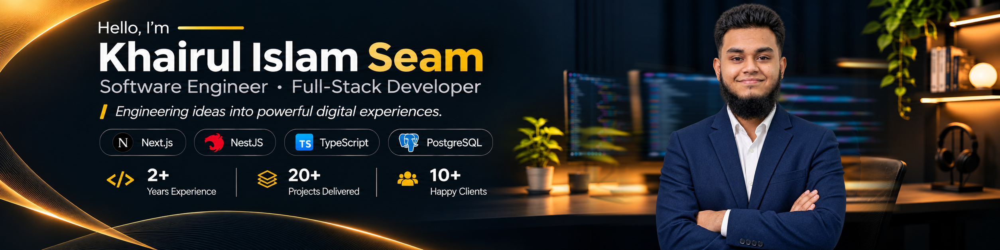

<h1 align="center">Hey there! I'm Khairul Islam Seam </h1>

<h3 align="center">Programmer · Problem Solver · Full-Stack Software Engineer</h3>

<i>Engineering ideas into powerful digital experiences.</i>

  

  

## 🚀 About Me

* Full-stack software engineer based in **Dhaka, Bangladesh 🇧🇩** with **2+ years of professional industry experience**.
* I build fast, scalable web applications and the backend services behind them — from the interface down to the **Linux VPS** they run on.
* Main stack: **TypeScript, Next.js, React, NestJS, Prisma, PostgreSQL**, plus **Node.js/Express, Laravel, MongoDB and MySQL** where the project calls for them.
* I like problems that need more than a screen: **data models, permissions, payments, real-time updates**, and the interfaces that make them usable.
* I spend extra time on the edges where products break — the retried payment, the cache that goes down, the file with the wrong extension, the visitor using a keyboard.
* 📚 **Currently studying:** C# & .NET Clean Architecture · System Design · Data Structures & Algorithms
* 🌐 Portfolio & case studies: [khairulislamseam.com](https://khairulislamseam.com)

---

## 🛠️ Featured Projects

Case studies read like worked problems: what was given, what had to be found, how I approached it, and the result.

| Project | What it is | Stack | Links |
|---|---|---|---|
| **SkillSync LMS** | Three-role learning platform: admins moderate, instructors publish and get paid, students learn, pay and earn verifiable certificates | Next.js 16 · NestJS 10 · Prisma 7 · PostgreSQL · Stripe · Socket.IO | [Live](https://academy.khairulislamseam.com/) · [Case study](https://khairulislamseam.com/projects/skillsync) |
| **Grabit** | Grocery marketplace with 10 roles, retry-safe (idempotent) payments, live chat and real-time rider tracking | Next.js 16 · Redux Toolkit · NestJS · Prisma 7 · Stripe · Leaflet | [Live](https://grabit-frontend-e-commerce.vercel.app/) · [Case study](https://khairulislamseam.com/projects/grabit) |
| **Ducati India** | Cinematic motorcycle platform with a procedural Web Audio engine simulator, ride simulator and TFT instrument cluster | Next.js 16 · React 19 · TypeScript · Web Audio API · GSAP · Zustand | [Live](https://ducati.khairulislamseam.com/) · [Case study](https://khairulislamseam.com/projects/ducati) |
| **FNM-eMART** | Gadget store running for a real Bangladesh business: guest checkout with COD and a Bangladesh delivery-rate engine | Laravel 12 · Livewire 3 · Tailwind CSS 4 · MySQL | [Case study](https://khairulislamseam.com/projects/fnm-emart) |
| **Islamic Canvases** | Bilingual luxury wall-art e-commerce & wholesale gallery with TensorFlow.js visual search, bKash + Steadfast dispatch and Bengali PDF invoicing | Next.js 16 · Express · MongoDB · TensorFlow.js · Socket.IO | [Case study](https://khairulislamseam.com/projects/islamic-canvases) |
| **Bistro Boss** | Restaurant e-commerce & reservations with Stripe checkout and an analytics admin dashboard | React 19 · Express 5 · MongoDB · Firebase Auth · Stripe | [Case study](https://khairulislamseam.com/projects/bistro-boss) |
| **Library Management API** | Clean Architecture REST API with JWT refresh tokens and three roles | C# · ASP.NET Core 10 · EF Core · SQLite | [Case study](https://khairulislamseam.com/projects/library-management-api) |

➡️ **All 13 projects:** [khairulislamseam.com/projects](https://khairulislamseam.com/projects)

---

## 🔧 Tech Stack

### ⚡ Languages

  
  
  
  
  
  
  
  
  

### 🎨 Frontend

  
  
  
  
  
  
  
  
  

### 🔗 Backend & APIs

  
  
  
  
  
  
  
  

### 🗄️ Databases

  
  
  
  
  
  
  

### 🛠️ DevOps & Tools

  
  
  
  
  
  
  
  

### 🤖 AI & Vision

  
  

---

## 💼 What I Can Build For You

| Service | What you get |
|---|---|
| **Full-Stack Development** | Complete web apps: Next.js App Router front ends, REST APIs with validation and role-based access, payments, real-time features and uploads |
| **Backend Engineering** | NestJS / Express / Laravel services with JWT refresh rotation, TOTP 2FA, idempotent payments, signed webhooks and rate limiting |
| **Database & Architecture** | PostgreSQL + Prisma, MySQL, MongoDB; schemas split by domain, modular monoliths, Clean Architecture in ASP.NET Core |
| **Programming & Problem Solving** | Data structures & algorithms, complexity analysis before optimisation, debugging to the root cause |
| **Creative Web Engineering** | GSAP + Lenis motion systems, responsive Tailwind layouts, keyboard / focus / reduced-motion support by default |
| **Deployment** | Live Linux VPS environments with Coolify, Nginx, PM2, Docker Compose, Cloudflare and SSL |

### 🧠 How I Work

1. **Understand before building** — people, data and constraints first, code after.
2. **Engineering over shortcuts** — validation at the boundary, types end to end, designed failure paths.
3. **Problem-solving mindset** — decompose, pick the data structure, measure, then optimise.
4. **Performance & reliability** — systems degrade gracefully instead of falling over.
5. **Continuous improvement** — every project leaves something new to learn.
6. **User-centered development** — fast, readable interfaces that work with a keyboard, a screen reader and a slow phone.

---

## 🎯 Currently Learning

- **C# & .NET Clean Architecture**
- **System Design** — replication and caching at scale
- **Data Structures & Algorithms**, in depth
- **Kubernetes, HAProxy** and **CI/CD pipelines**

---

## 📊 GitHub Stats

<!--
  All cards below come from github-profile-summary-cards and the streak-stats service,
  which stay up reliably (the old github-readme-stats / trophy / activity-graph
  Vercel instances are rate-limited and often show broken images).
-->

  
  

  
  

  
  

---

## 🤝 Let's Work Together

Have a product to build, a system to fix, or a role to fill? Tell me what you're working on.

  

### 📫 Get In Touch

